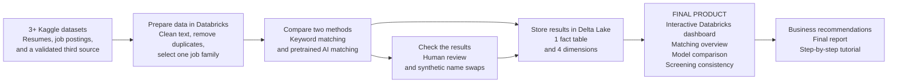

# AI Resume Matching and Screening Consistency

An IS 4030 data project by **Skynet Squad**.

**Databricks setup:** Open **Workspace > Shared > IS4030-ATS-project > notebooks**. Follow the [Databricks start guide](docs/DATABRICKS-START-HERE.md) for table locations, notebook order, and role handoffs.

Our final product is an **interactive Databricks dashboard** that helps explain where automated resume matching works well and where a person should review its results. A SQL star schema in Delta Lake supports the dashboard. Two scoring methods supply measurements for the team's analysis.

We are building a small screening experiment, not testing a commercial ATS. Our results will describe our sample and methods, not every hiring system.

## How the project works



**Example:** A job asks for SQL and Power BI. We compare a resume using those exact terms with one describing related work in different words. The dashboard shows how the two methods rank the candidates and how those results compare with our team's independent review. We also change synthetic names while keeping qualifications identical to see whether scores change.

## What the dashboard will show

| Page | What users can explore | Question it answers |
| --- | --- | --- |
| Matching overview | Selected jobs, resume counts, score distributions, and ranked matches | Which resumes does each method consider similar to a job? |
| Model comparison | Keyword and AI scores, ranking differences, and human-review results | Does semantic matching agree more closely with our reviewers on the reviewed sample? |
| Screening consistency | Paired score and rank changes when only synthetic names change | Are our methods sensitive to a name change when qualifications stay the same? |

Users will filter by job and model, with relevant/control categories and experiment conditions where appropriate. Scores measure text similarity, not a candidate's probability of being hired. We will not show hiring funnels or outcomes that our sources do not contain.

## Study scope

- **One job family:** Data Analyst / Business Intelligence.
- **2–3 target job postings and 300–500 resumes:** 70% tech/data relevant and 30% out-of-domain controls, such as healthcare or sales.
- **Keyword baseline:** scikit-learn TF-IDF and cosine similarity.
- **AI method:** pretrained [all-MiniLM-L6-v2](https://huggingface.co/sentence-transformers/all-MiniLM-L6-v2) embeddings and cosine similarity. We are not training a model from scratch.
- **Human review:** 30–50 unique resume/job pairs rated with a documented 1–5 rubric.
- **Consistency experiment:** synthetic name changes on identical qualifications, using fixed scoring methods and the same qualification text.

The small mock example will contain two jobs and four resumes so we can check the workflow before loading the full study sample. It is not evidence of model accuracy.

## Data and warehouse

The course requires **at least three distinct raw datasets**. Proposed sources are [resumes](https://www.kaggle.com/datasets/saugataroyarghya/resume-dataset), [LinkedIn data jobs](https://www.kaggle.com/datasets/joykimaiyo18/linkedin-data-jobs-dataset), and [recruitment data](https://www.kaggle.com/datasets/surendra365/recruitement-dataset). The team must validate their contents, licenses, quality, and integration before final selection. The third source must have a useful, documented role; we will not invent links between unrelated candidates.

Databricks will hold raw data, cleaned study inputs, and the final Delta tables. The star schema will include:

- `fact_evaluation`: one resume/job/model/test-condition evaluation in the frozen study run.
- `dim_resume`: candidate study records and relevant/control categories.
- `dim_job`: the selected job postings.
- `dim_model`: keyword and semantic methods.
- `dim_test_condition`: normal scoring and controlled name-test conditions.

Human ratings and detailed audit results will live in companion tables. The scoring output contract is:

```text
evaluation_id, resume_id, job_id, model_name,
similarity_score, rank_position, test_condition_id
```

The team will preserve source IDs, preparation decisions, sample IDs, model versions, and verification evidence so the results can be reproduced.

## Who owns the work

| Role | Main responsibility | GitHub work |
| --- | --- | --- |
| Project Manager / AI and Testing Lead | AI implementation, testing, coordination, instructor feedback, AI log, and combined submissions | [Scoring](https://github.com/wadeburton/IS4030-ATS-project-/issues/3), [audits](https://github.com/wadeburton/IS4030-ATS-project-/issues/4), and testing across all issues |
| Data Engineer | Validate three sources, clean and sample data, and document ETL | [Data foundation](https://github.com/wadeburton/IS4030-ATS-project-/issues/1) |
| BI Data Architect | Build the Delta star schema, relationships, and loading queries | [Warehouse](https://github.com/wadeburton/IS4030-ATS-project-/issues/2) |
| Dashboard Developer | Build and document the three Databricks dashboard pages | [Dashboard and delivery](https://github.com/wadeburton/IS4030-ATS-project-/issues/5) |
| Business Strategist | Business case, review rubric, research, interpretation, and recommendations | [Validation](https://github.com/wadeburton/IS4030-ATS-project-/issues/4) and [report](https://github.com/wadeburton/IS4030-ATS-project-/issues/5) |

The Project Manager owns testing. Other roles check their own outputs and provide evidence. All members contribute independent human ratings and document their actual AI assistance.

## Course deliverables

1. **Deliverable 1: Charter, scope, and data foundation.** Confirm roles and Databricks, identify three datasets and their integration, and create an owned report/tutorial outline.
2. **Deliverable 2: Preliminary architecture and report.** Submit at least five fully written pages, an initial star-schema diagram, APA research, actual data-loading screenshots, tutorial progress, and early AI-log entries. Meet with the instructor for feedback.
3. **Deliverable 3: Final analysis and report.** Deliver the working dashboard, validated warehouse, 10–15 page core report, evidence-based recommendations, reproducible tutorial, final AI Verification Log, and one-page AI reflection.

Detailed role instructions and checklists are in [Issue #5](https://github.com/wadeburton/IS4030-ATS-project-/issues/5). Every role supplies its own written sections, screenshots, tutorial steps, and verification evidence.

## Current status and limits

### Live Databricks preview

The existing Databricks dashboard is connected to preview tables in
`workspace.is4030_silver`. Open **Data Intelligence → Dashboards**, then
**ATS Resume Matching and Screening Consistency**. The dashboard has Matching
Overview, Keyword vs AI, and Screening Consistency pages.

The 2026-09-29 exploratory run used two LinkedIn postings (Data Analyst and
Business Intelligence Analyst) and 300 resumes: 210 records labeled for data or
technology roles and 90 nursing/sales controls. Both TF-IDF and
`sentence-transformers/all-MiniLM-L6-v2` scored every resume/job pair, producing
1,200 rows. Missing fields were omitted, unusable rows skipped, and every selected
resume/job text was capped to 1,000 characters and the model's actual token limit.
The quality table records these preparation actions. Contact details and the
recruitment dataset's applicant name were removed from model text.

This is a preview, not the final cleaned study. Role labels are sample-group proxies.
The model scores differ in scale and must not be compared as percentages. No
independent human ratings, controlled name-swap results, accuracy claims, or
demographic discrimination findings are in the dashboard yet. The final score
tables should later be added to the required fact/dimension schema after the team
reviews the sample and freezes its study method.

The tables for this run are listed in
`.build-databricks/deployed-preview-tables.json` on the project owner's computer;
that file and the source records are intentionally excluded from GitHub. The
dashboard definition is versioned at
[`dashboards/ats-screening-preview.lvdash.json`](dashboards/ats-screening-preview.lvdash.json).

### Ranking preview

`notebooks/05_keyword_demo.py` runs the keyword baseline on two synthetic jobs and
four synthetic resumes, without writing to any tables. The fourth resume is an
identical-text tie control, not a completed name-swap experiment. Select serverless
Python compute and run the cells in order. This notebook has been checked locally
for syntax; its Databricks execution still needs verification.

`ats_scoring.score_keyword` accepts prepared ID/text records, validates inputs,
fits TF-IDF on the fixed batch, and returns the seven fact-table columns. It ranks
using full precision with resume ID as a deterministic tie-breaker, then rounds
scores to three decimals. These are similarity scores, not qualification percentages.
Evaluation IDs identify one frozen study run; do not append reruns as new observations.
The missing-input option remains in `prepare_records` before scoring.

### Interactive app build

The first local app and gated run slice now lives under `app/`, `ats_pipeline.py`,
and `notebooks/07_*` / `08_ats_runner.py`. It supports a selected job and method,
records per-run quality checks, blocks scores on failed critical checks, and shows
ranked results and the method inputs in a small Streamlit control surface.
`docs/DATABRICKS-APP-SETUP.md` lists the Databricks steps to create its tables,
prepare the study sample, attach the SQL warehouse and runner job, and deploy.
The four pipeline behaviors have local unit coverage, and the full local suite
passed on 2026-11-19. The app has not yet been deployed or run against the live
workspace; table permissions, app resources, and notebook/job execution still need
workspace verification.

Run local checks with `python -m pip install -r requirements.txt`, then
`python -m unittest discover -s tests -v`.

The intended connection is **Databricks data -> scoring notebook -> Delta results
tables -> SQL dashboard**. A separate AI agent is unnecessary. The live preview is
connected; the repeatable Databricks notebook run and final study workflow still need
team verification. Do not use separately refitted keyword batches for a paired name
audit.

The Databricks foundation includes three raw source tables, a source manifest, separate schemas for cleaned inputs and reporting, and the required one-fact/four-dimension star schema. Raw row counts were verified at 9,544 resumes, 1,048 job postings, and 10,000 recruitment records. The [source manifest](docs/source-manifest.json) records file hashes and column mappings. The project dashboard now shows exploratory model results; cleaning, human validation, paired identity-cue testing, and final star-schema loading remain tracked by the five issues.

Similarity alone does not establish matching accuracy. The small human-review sample supports a limited comparison, and synthetic name tests do not prove demographic discrimination or real hiring outcomes. Recommendations will follow the observed results and these limits.
