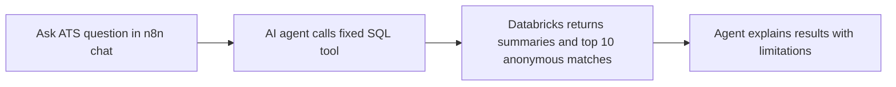

# ATS results chat agent in n8n

This workflow lets a teammate ask questions in n8n chat and get answers grounded in the Databricks ATS preview table. It uses a fixed SQL query to read summary statistics and the top 10 anonymous resume IDs for each job and scoring method. The agent cannot generate SQL or write to Databricks.

The retrieval is SQL over structured scoring results, followed by an AI answer grounded in those rows. It does not retrieve or send raw resumes, names, or contact details. The table currently contains similarity scores, ranks, and anonymous IDs, so this agent cannot explain resume text or claim demographic fairness, hiring accuracy, or actual hiring outcomes.

## Import and connect it

1. In n8n, open **Workflows**, choose **Import from File**, and select `ats-rag-agent.json`.
2. Open **Read ATS Results (Fixed Query)** and create/select a Databricks credential for your workspace. Grant it SQL access, **CAN USE** on the SQL warehouse, and `USE CATALOG`, `USE SCHEMA`, and `SELECT` on `workspace.is4030_silver.ats_preview_20260929_172928_scores`.
3. Confirm the SQL warehouse ID in the node is `b5fcad890d7d8f13`. Change it only if your team uses a different warehouse.
4. Open **Chat Model**, create/select your n8n OpenAI credential, or replace this node with a chat model your team already has configured.
5. Test the Databricks node by running the workflow from chat. If the table name has changed, update only the fixed table reference in its SQL query.
6. Click **Save**. Use **Chat** / **Open Chat** in the workflow to ask a question.

Try: “Compare the average scores for both models by job.” “Which anonymous resume IDs are top ranked for job 1?” “Does this prove the AI model is unbiased?”

## Access and limits

Use a Databricks identity with read-only table privileges. Never give the workflow a credential with permission to update project tables. n8n credentials are not included in the exported JSON and must be added in your n8n account. Do not expose this chat publicly; the Chat Trigger is configured as private.

If the agent answers without calling the tool, prompt it to retrieve the data. The query only returns summary stats and ranks 1–10 per job and model. The rest of the ranked results are not in the prompt context.

## Simple flow

